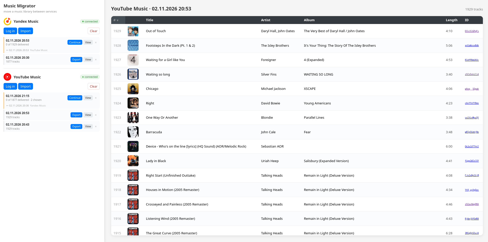
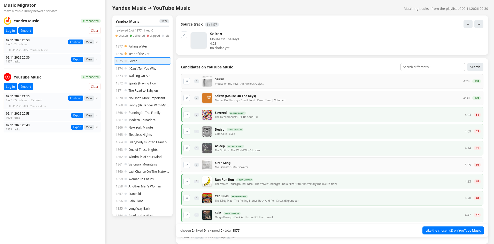

# Music Migrator

Move your liked-tracks library between **Yandex Music** and **YouTube Music**, in either direction.



## How it works

1. **Connect a service.**
   - *Yandex Music:* press **Log in with Yandex** and confirm the code on the Yandex page.
   - *YouTube Music:* copy the request headers from the YouTube Music website and paste them into the app (see [Tokens](#tokens)).
2. **Import.** Takes a snapshot of the service's liked tracks and stores it in the app. Snapshots are listed in the sidebar under their service, labelled with the import date.
3. **Export.** Creates a *target* from a source playlist. Choose where the tracks should land: a **new playlist** on the destination service, or its **liked tracks**.

   

4. **Match.** Each source track is searched on the other service by `title + artist` and candidates are ranked by a fuzzy score based on title, artist and duration, with a small penalty for music videos. Pick a candidate or skip it. Choices are saved immediately.
5. **Apply.** Chosen tracks are sent in source-playlist order, 50 at a time.
   - Safe to re-run: applied tracks are marked and never sent twice.
   - For a playlist target, the remote playlist is created with the first batch and appended to afterwards.
   - Progress is shown on the sidebar row.

### Clearing

**Clear** (on each service row) empties that service's liked library. You must type the service name to confirm. It never touches snapshots already imported into the app.

## Running

**With Docker**

```sh
docker compose up --build
# open http://localhost:8000
```

**Without Docker**

```sh
pip install -r requirements.txt
uvicorn app.main:app --reload
```

### Data storage

Everything is stored in a single SQLite file at `data/app.db` (or `$DATA_DIR/app.db`). Compose bind-mounts `./data`, so the database is a normal file you own: open it with any SQLite client or copy it. It survives `docker compose down -v`.

## Tokens

### Yandex Music

Press **Log in with Yandex** in the sidebar. The app requests a device code from Yandex, displays it, and waits while you confirm it at <https://ya.ru/device>. The token is then saved to the local database.

Pasting a token manually still works as a fallback ([how to get one](https://yandex-music.readthedocs.io/en/main/token.html)).

### YouTube Music

1. Open <https://music.youtube.com> and press **F12** → **Network**.
2. Find a `/browse` request.
3. Copy the whole request header block and paste it into the app.

See the [ytmusicapi setup guide](https://ytmusicapi.readthedocs.io/en/stable/setup/browser.html) for details.

> [!NOTE]
> Tokens are never shared. They stay on your machine, stored in `data/app.db`.

## Tests

```sh
pytest tests -q
```

## Credits

Neither service publishes a public music API for this, so the app relies on two unofficial Python clients built by reverse-engineering the web clients:

- **[yandex-music](https://github.com/MarshalX/yandex-music-api)** by MarshalX: the Yandex Music client, including the device-code login flow.
- **[ytmusicapi](https://github.com/sigma67/ytmusicapi)** by sigma67: the YouTube Music client, which is where the pasted-header-block token comes from.

Thanks to both maintainers.
